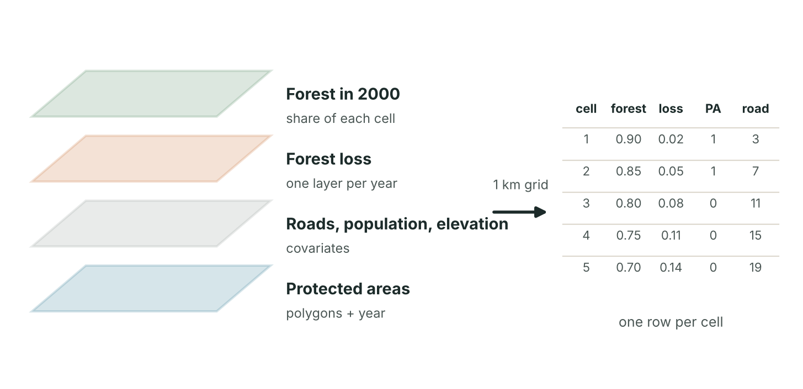

Load the layers in `data/`, look at them, and turn them into one table with a row per \~800 m grid cell that every unit uses.

{#fig-concept fig-alt="Concept: many layers, one grid, one table."}

```{r}
#| label: setup
library(tidyverse)  # dplyr, ggplot2, tibble, purrr
library(sf)         # vector layers (parks, roads, districts)
library(terra)      # raster layers (forest, loss, elevation, population)
```

# 1. Load and look

Vector layers load as `sf` data frames, so they work with dplyr and ggplot2. Rasters load as `terra` objects.

```{r}
#| label: load
belize    <- st_read("data/belize.gpkg", quiet = TRUE)
pa        <- st_read("data/pa_belize.gpkg", quiet = TRUE)        # parks, with designation year
roads     <- st_read("data/roads_belize.gpkg", quiet = TRUE)     # major roads, current OSM
districts <- st_read("data/districts.gpkg", quiet = TRUE)

forest <- rast("data/forest2000_300m.tif")    # share of cell forested in 2000
loss   <- rast("data/forest_loss_300m.tif")   # 23 layers: share lost each year, 2001–2023
elev   <- rast("data/elevation_1km.tif")
pop    <- rast("data/population_2000.tif")    # people per km², 2000
```

The rasters are on different grids. Compare their cell sizes (in degrees; 0.01° is about 1.1 km):

```{r}
#| label: resolution
tibble(layer    = c("forest", "loss", "elev", "pop"),
       cell_deg = map_dbl(list(forest, loss, elev, pop), \(r) res(r)[1]),
       n_cells  = map_dbl(list(forest, loss, elev, pop), ncell))
```

Now map the forest with the parks and roads. `as.data.frame(raster, xy = TRUE)` turns a raster into a table that ggplot2 can draw.

```{r}
#| label: map-forest
forest_df <- as.data.frame(forest, xy = TRUE) |> rename(share = 3)

ggplot() +
  geom_raster(data = forest_df, aes(x, y, fill = share)) +
  geom_sf(data = pa, fill = NA, colour = "black") +
  geom_sf(data = roads, colour = "firebrick", linewidth = 0.3) +
  scale_fill_distiller(palette = "Greens", direction = 1) +
  coord_sf(expand = FALSE) +
  labs(fill = "Forest share\nin 2000", title = "Forest, parks (black) and major roads (red)") +
  theme_void()
```

::: {.callout-note title="Your task"}
1.  When were the parks designated? Plot `pa$STATUS_YR`.
2.  How much forest is lost each year? Use `global(loss, "sum", na.rm = TRUE)`.
3.  Where was forest lost between 2006 and 2023? Sum those layers and map them with the parks on top.
:::

::: {.callout-note title="Solution" collapse="true"}
```{r}
#| label: look-solution
ggplot(pa, aes(STATUS_YR)) + geom_histogram(binwidth = 5) +
  labs(x = "Year designated", y = "Parks")

tibble(year = 2001:2023, lost = global(loss, "sum", na.rm = TRUE)[[1]]) |>
  ggplot(aes(year, lost)) + geom_line() +
  labs(x = NULL, y = "Forest lost (cell-area units)")

loss_df <- sum(loss[[paste0("loss_", 2006:2023)]]) |> as.data.frame(xy = TRUE) |> rename(share = 3)
ggplot() +
  geom_raster(data = loss_df, aes(x, y, fill = share)) +
  geom_sf(data = pa, fill = NA, colour = "grey30") +
  scale_fill_distiller(palette = "YlOrRd", direction = 1) +
  coord_sf(expand = FALSE) +
  labs(fill = "Share lost\n2006–2023") +
  theme_void()
```
:::

::: {.callout-note title="Question"}
Are parks where the frontier is, or away from it? What does that mean for a naive comparison?
:::

# 2. Put everything on one grid

Each raster has its own grid, so we make one common grid and move every layer onto it. `terra` is the tool for this step; after it we only use dplyr and ggplot2.

::: {.callout-note title="Your task"}
1.  `aggregate()` `forest` and `loss` by a factor of 3 (\~800 m) so each cell holds shares.
2.  `rasterize()` the parks onto that grid with the **earliest** designation year per cell (`field`, `fun`).
3.  Put elevation on the same grid with `project()`. Which `method` for a continuous variable on a coarser grid?
4.  Add the other covariates: slope (`terrain()`), km to the nearest major road (`rasterize()` the roads, then `distance()`), population (`project()`), and district (`rasterize()` with `field = "NAME_1"`).
:::

```{r}
#| label: grid-task
#| eval: false
x <- aggregate(c(forest, loss), ___, mean)
x$pa_year   <- rasterize(vect(pa), x, field = ___, fun = ___)
x$elev      <- project(elev, x, method = ___)
x$slope     <- project(terrain(___, "slope"), x, method = "average")
x$dist_road <- distance(rasterize(vect(roads), ___)) / 1000
x$pop       <- project(___, x, method = "average")
x$district  <- rasterize(vect(districts), x, field = ___)
```

::: {.callout-note title="Solution" collapse="true"}
```{r}
#| label: grid-solution
x <- aggregate(c(forest, loss), 3, mean)
names(x)[1] <- "forest2000"

x$pa_year   <- rasterize(vect(pa), x, field = "STATUS_YR", fun = "min")  # earliest park
x$elev      <- project(elev, x, method = "average")
x$slope     <- project(terrain(elev, "slope"), x, method = "average")    # degrees
# slope is undefined at the coast and raster edge: fill from neighbouring cells
x$slope     <- focal(x$slope, 3, "mean", na.policy = "only", na.rm = TRUE)
x$dist_road <- distance(rasterize(vect(roads), x)) / 1000                # km to a major road
x$pop       <- project(pop, x, method = "average")
x$district  <- rasterize(vect(districts), x, field = "NAME_1")

# remoteness: km to land already cleared by 2000
x$dist_frontier <- distance(ifel(x$forest2000 < 0.3, 1, NA)) / 1000

x <- mask(x, vect(belize))
writeRaster(x, "data/grid.tif", overwrite = TRUE)
```
:::

# 3. One row per cell

Turn the grid into a table, then build the variables the other units use.

```{r}
#| label: cells
# parks designated by 2005, as one shape (the "treated" area)
early_parks <- pa |> filter(STATUS_YR <= 2005) |> st_union()

cells <- as_tibble(as.data.frame(x, xy = TRUE)) |>
  # keep mostly-forested cells; a few coastal cells have no district or slope
  filter(forest2000 > 0.5, !is.na(elev), !is.na(pop), !is.na(slope), !is.na(district)) |>
  mutate(cell     = row_number(),
         # loss in 2001–2005 and loss in 2006–2023 (as a share of the forest left in 2005)
         pre_loss = rowSums(pick(loss_2001:loss_2005)),
         loss     = rowSums(pick(loss_2006:loss_2023)) / (forest2000 - pre_loss),
         # protected by 2005 (treated), or in a park designated later (late)
         treated  = as.integer(!is.na(pa_year) & pa_year <= 2005),
         late     = !is.na(pa_year) & pa_year > 2005)

# signed distance to the edge of those parks in km: + inside, − outside
cells <- cells |>
  mutate(dist_edge = as.numeric(st_distance(st_as_sf(cells, coords = c("x", "y"), crs = 4326),
                                            st_boundary(early_parks))) / 1000,
         dist_edge = if_else(treated == 1, dist_edge, -dist_edge))

saveRDS(cells, "data/cells.rds")
count(cells, treated, late)
```

::: {.callout-warning title="Timing"}
Covariates should describe the land **before** parks were designated. Population is from 2000, before any park here was designated, but the roads are today's OpenStreetMap, so they may have been shaped by the parks (a road not built into a park). Where would that put them in your DAG, and what does it do to an estimate that controls for them?
:::

::: {.callout-tip title="Why 2005? The time structure"}
Forest loss is observed from 2001, but most parks are far older (about 11,000 cells are in parks designated by 2005, only about 100 after). So the units use 2005 as a cutoff:

- **Units 1–3 (DAGs, RD, matching):** `treated` means in a park designated by 2005, and the outcome is loss over 2006–2023 as a share of the forest standing in 2005. Protection is already in place before the outcome window, and 2001–2005 serves as the "before" period (`pre_loss`). Cells in later parks (`late`) are set aside.
- **Unit 4 (DiD):** the later parks (designated after 2005) are the natural treated group, because they are the only ones with a before and an after in the data.

The cutoff is a judgment call, and the two designs answer different questions (long-standing protection vs. new designation).
:::

::: {.callout-note title="Questions"}
1.  Why keep only cells that were mostly forest in 2000?
2.  Why is the outcome a share of the forest standing in **2005**?
3.  Why set aside cells in parks designated after 2005 (`late`)?
:::

# 4. Explore the cell table

`cells` is the data every other unit uses, so look at it before moving on.

```{r}
#| label: explore
# where are protected cells?
ggplot(cells, aes(x, y, fill = factor(treated, labels = c("Never protected", "Protected by 2005")))) +
  geom_raster() +
  geom_sf(data = belize, inherit.aes = FALSE, fill = NA, colour = "grey40") +
  scale_fill_manual(values = c("grey75", "darkgreen")) +
  coord_sf(expand = FALSE) +
  labs(fill = NULL) +
  theme_void()

# do protected and unprotected cells differ before any analysis?
cells |>
  filter(!late) |>
  group_by(treated) |>
  summarise(n = n(),
            across(c(loss, pre_loss, forest2000, dist_frontier, dist_road, elev, slope, pop), mean))

# how many cells are near a park boundary? (matters for Unit 2)
ggplot(cells, aes(dist_edge)) + geom_histogram(binwidth = 1)
```

::: {.callout-note title="Questions"}
1.  Compare the two rows of the summary table. Which covariates differ most? Forest loss is much lower in protected cells: does that mean parks work? Say which covariates make you doubt it.
2.  Look at the map. Could you find unprotected cells next to protected cells? Where are there none?
3.  The histogram of `dist_edge` peaks at 0. Why does that help the RD design in Unit 2, and what does it say about how many cells are within 1 km of a boundary?
4.  `pre_loss` is already lower in protected cells, before the outcome window starts. What does that suggest?
:::
