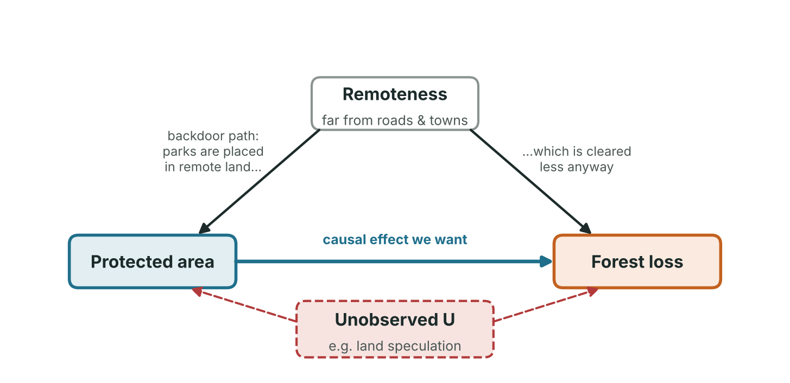

Write the board DAG in code, ask it what to control for, and check its testable claims against the Belize data. Run `00_layers.qmd` first.

{#fig-concept fig-alt="Concept: a DAG says what to control for."}

```{r}
#| label: setup
library(dplyr)
library(dagitty)
cells <- readRDS("data/cells.rds") |> filter(!late, is.finite(loss))
```

# 1. The board DAG in code

The nodes are the columns of `cells`, so the DAG can be checked against the data. Two nodes are not in the data: `U` (unmeasured) and `patrols` (a mechanism we have no layer for).

```{r}
#| label: dag
dag <- dagitty('dag {
  treated [exposure] ; loss [outcome] ; U [latent]

  elev -> slope ; elev -> dist_frontier ; elev -> treated
  slope -> treated ; slope -> loss
  dist_road -> dist_frontier ; dist_road -> pop
  dist_road -> treated ; dist_road -> loss
  pop -> treated ; pop -> loss
  dist_frontier -> treated ; dist_frontier -> loss
  forest2000 -> treated ; forest2000 -> loss
  district -> treated ; district -> loss
  U -> treated ; U -> loss

  treated -> patrols -> loss ; treated -> loss
}')
plot(graphLayout(dag))
paths(dag, "treated", "loss")
adjustmentSets(dag)
```

::: {.callout-note title="Questions"}
1. Which paths are open? `adjustmentSets()` returns nothing at all. Why can no set of observed variables block every back-door path? (This is different from an adjustment set that is empty, `{}`, which would mean no control is needed.)
2. Remove `U`. What must you control for now (you should get `dist_frontier`, `dist_road`, `district`, `forest2000`, `pop` and `slope`)? Why is `elev` not needed? What must you leave out, and why?
3. `dist_road` uses today's roads, which a park may have stopped from being built (see the Timing note in Unit 0). Is there an arrow you'd add, remove or reverse? `dagitty` needs a graph with no cycles, so check that your change still gives an answer from `adjustmentSets()`.
:::

# 2. A DAG makes claims you can test

Every missing arrow implies an independence. `dagitty` lists them, and `localTests()` checks them against data.

```{r}
#| label: tests
# The same DAG with only the measured numeric variables (no U, patrols or district),
# since the tests use correlations
dag_obs <- dagitty('dag {
  treated [exposure] ; loss [outcome]
  elev -> slope ; elev -> dist_frontier ; elev -> treated
  slope -> treated ; slope -> loss
  dist_road -> dist_frontier ; dist_road -> pop
  dist_road -> treated ; dist_road -> loss
  pop -> treated ; pop -> loss
  dist_frontier -> treated ; dist_frontier -> loss
  forest2000 -> treated ; forest2000 -> loss
  treated -> loss
}')
impliedConditionalIndependencies(dag_obs)

dat <- cells |> select(treated, loss, elev, slope, dist_road, pop, dist_frontier, forest2000)
localTests(dag_obs, dat, type = "cis")
```

::: {.callout-note title="Questions"}
1. Which implied independences does the data reject? Which are rejected most strongly (largest `estimate`)? Which missing arrows, or shared causes such as a common `location`, does that point to? With this many cells even tiny correlations are significant, so look at the `estimate` column and the confidence interval, not only the p-value.
2. Passing these tests doesn't prove the DAG. Why not? (Hint: the tests cannot see `U`.)
:::

::: {.callout-tip title="Reading the output"}
Each row is one claim of the form "A is independent of B given C". `estimate` is the (partial) correlation, which should be near 0 if the DAG is right. A row whose interval excludes 0 means that arrow or a common cause is missing from the DAG.
:::

# 3. What the DAG does to the estimate

::: {.callout-note title="Your task"}
Estimate the effect of `treated` on `loss` three ways: (a) no controls, (b) the adjustment set from your DAG (without `U`, which you cannot measure), (c) your adjustment set **plus** a bad control. For (c), try neighbours' loss after 2005 (compute it from `data/grid.tif` with `terra::focal()`), or anything else your DAG says is downstream of `treated`.
:::

```{r}
#| label: estimates
lm(loss ~ treated, cells)
lm(loss ~ treated + dist_frontier + forest2000 + slope + dist_road + log1p(pop) + district, cells)
```

::: {.callout-note title="Reflection"}
Which node in your DAG worries you most, and which of the next units (RD, matching, DiD) is built to deal with it?

How different are (a) and (b)? The change from (a) to (b) is the confounding that observed variables removed. What remains is what `U` could still be doing.
:::
