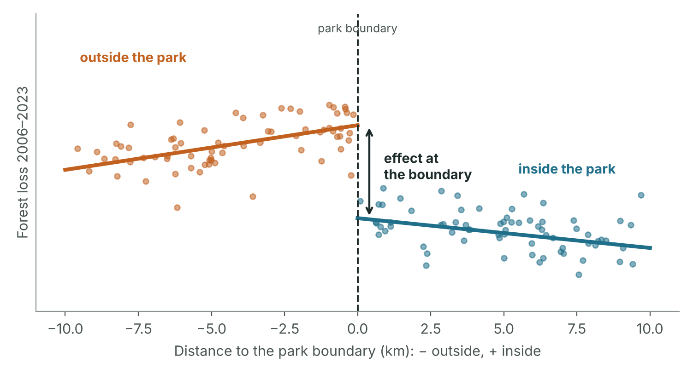

Compare forest just inside and just outside parks designated by 2005. The outcome is `loss`, the share of 2005 forest lost by 2023, so a **negative** jump means less loss inside the park. The running variable is signed distance to the boundary (`dist_edge`: positive inside, negative outside). Run `00_layers.qmd` first.

{#fig-concept fig-alt="Concept: compare cells just inside and just outside the boundary."}

```{r}
#| label: setup
library(tidyverse)
library(rdrobust) # check out this package documentation!
cells <- readRDS("data/cells.rds")

near <- cells |> filter(!late, is.finite(loss), abs(dist_edge) <= 10)
count(near, treated)
```

# 1. Plot it

```{r}
#| label: rdplot
rdplot(near$loss, near$dist_edge, c = 0,
       x.label = "Distance to boundary (km), + inside", y.label = "Share of 2005 forest lost")
```

::: {.callout-note title="Question"}
Can you see a jump at 0? If you can't see it, be sceptical of any number.
:::

# 2. Estimate the jump

```{r}
#| label: rdrobust
summary(rdrobust(near$loss, near$dist_edge, c = 0))
```

::: {.callout-tip title="Reading the output"}
- **Coef.** is the jump at the boundary: loss just inside minus loss just outside, in share of forest lost. Report the **Robust** row (bias-corrected estimate, robust standard error and confidence interval); *Conventional* is the uncorrected version.
- **Bandwidth (BW est. h)** is how many km on each side the estimate uses. Only cells inside it matter, and `Eff. Number of Obs.` shows how many that is. A tiny count means a noisy estimate.
- A confidence interval that includes 0 means the data can't separate a park effect from no effect, which is not the same as showing there is none.
- Compare the size of the jump with the average loss outside near the boundary to judge whether it is large or trivial.
:::

# 3. Check the assumption

Nothing except protection should jump at the boundary. Test the covariates as if they were outcomes.

::: {.callout-note title="Exercise"}
Run `rdrobust()` with `elev`, `slope`, `forest2000`, `dist_frontier`, `dist_road` and `pop` as the outcome. Do any jump? What would that tell you about where boundaries were drawn?

A jump in a covariate means cells on the two sides were not alike before protection, which undermines the RD. With six tests, expect about one false alarm by chance, so look for large jumps in meaningful variables rather than a single p-value just under 0.05.
:::

# 4. Stress tests

::: {.callout-note title="Exercise"}
**Donut:** drop cells with `abs(dist_edge) < 1` and re-estimate. Does the estimate move? If it does, cells right at the edge may be affected by leakage or by imprecise boundaries. Also try `h =` set to half and double the default bandwidth: a result that only holds for one bandwidth is fragile.
:::

::: {.callout-note title="Discuss"}
1. RD estimates the effect *at the boundary*. Is that larger or smaller than the effect deep inside a park, and why?
2. Belize's parks sit on rivers, ridges, the coast and the Guatemalan border. Which edges should you drop?
:::

# Bonus: How sensitive is the estimate?

Optional, if you have time. An RD estimate should not depend on one arbitrary choice of bandwidth, and it should not appear where there is no boundary.

## Bandwidth

Re-estimate the jump using a fixed bandwidth `h` (km on each side) from 1 to 8, and plot the robust estimate with its confidence interval.

```{r}
#| label: bonus-bandwidth
# robust estimate and 95% CI for one bandwidth `h` and cutoff `c`, using data `d`
rd_est <- function(h, c = 0, d = near) {
  r <- rdrobust(d$loss, d$dist_edge, c = c, h = h)
  tibble(h = h, c = c,
         estimate = r$coef["Robust", ],
         lo = r$ci["Robust", 1], hi = r$ci["Robust", 2])
}

bw <- map(c(1, 2, 3, 5, 8), rd_est) |> list_rbind()

ggplot(bw, aes(h, estimate, ymin = lo, ymax = hi)) +
  geom_hline(yintercept = 0, linetype = "dashed") +
  geom_pointrange() +
  labs(x = "Bandwidth (km on each side)", y = "Jump in share of forest lost")
```

::: {.callout-note title="Questions"}
1. Does the estimate stay about the same as `h` changes, or does it move? How does the width of the interval change, and why?
2. The default bandwidth chosen by `rdrobust()` is in the output above. Where does it sit on this plot?
:::

## Placebo boundaries

Pretend the boundary is somewhere it isn't. A real park effect should appear at 0 and nowhere else. To keep the placebo clean, use only cells on one side of the real boundary: outside cells for cutoffs at -2 and -4 km, inside cells for +2 and +4 km.

```{r}
#| label: bonus-placebo
placebo <- map(c(-4, -2, 2, 4), \(c0) {
  side <- if (c0 < 0) filter(near, dist_edge < 0) else filter(near, dist_edge > 0)
  rd_est(h = 3, c = c0, d = side)
}) |> list_rbind()

# add the real boundary (c = 0, all cells) with the same bandwidth for comparison
placebo <- bind_rows(placebo |> mutate(type = "Placebo"),
                     rd_est(h = 3) |> mutate(type = "Real boundary"))

placebo |> arrange(c)

ggplot(placebo, aes(c, estimate, ymin = lo, ymax = hi, colour = type)) +
  geom_hline(yintercept = 0, linetype = "dashed") +
  geom_pointrange() +
  labs(x = "Cutoff (km from the real boundary)", y = "Jump in share of forest lost",
       colour = NULL)
```

::: {.callout-note title="Questions"}
1. Do any placebo cutoffs show a jump? How do their size and intervals compare with the real estimate at 0 (same bandwidth, so the comparison is fair)?
2. If a placebo jump is as large as the real one, what does that say about the real one? If one is borderline, what would you check next? (Think about what else changes with distance from a park edge.)
:::
