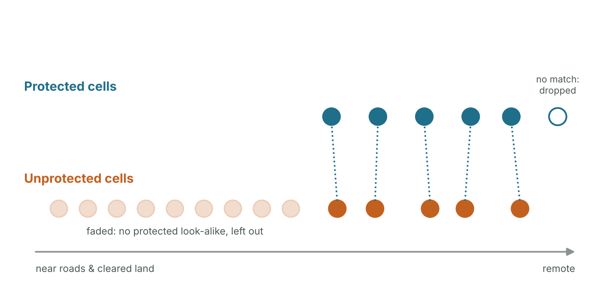

Build a comparison group of unprotected cells that look like protected ones on the confounders from your DAG. Run `00_layers.qmd` first.
 Run `00_layers.qmd` first.
{#fig-concept fig-alt="Concept: compare protected cells with unprotected cells that look like them."}

```{r}
#| label: setup
library(dplyr)
library(MatchIt)
library(cobalt)
library(sensemakr)
cells <- readRDS("data/cells.rds") |> filter(!late, is.finite(loss))
f <- treated ~ dist_frontier + dist_road + elev + slope + forest2000 + log1p(pop) + district   # from your DAG

# Unit 0 leaves rasters named `pop`, `elev`, `loss`... in your session. cobalt would find
# those instead of the columns, so evaluate the formula against `cells` only.
environment(f) <- list2env(cells, parent = baseenv())
```

# 1. How different are the groups?

```{r}
#| label: before
bal.tab(f, data = cells, binary = "std", s.d.denom = "treated")
```

::: {.callout-note title="Question"}
Which covariate differs most? Which way would that bias a naive comparison?
:::

# 2. Match and check balance

```{r}
#| label: match
m <- matchit(f, data = cells, method = "nearest", distance = "glm", caliper = 0.1)
summary(m)$nn
love.plot(m, binary = "std", thresholds = c(m = 0.1), abs = TRUE)
```

::: {.callout-note title="Questions"}
1. Is every covariate under 0.1 after matching?
2. How many protected cells were dropped by the caliper? What population does the estimate now describe?
:::

# 3. Estimate

```{r}
#| label: att
# Matched estimate: match.data() keeps only matched cells, plus a `weights` column.
# Regressing loss on treated with those weights gives the difference in mean loss
# between protected cells and their matched controls (the ATT).
att <- lm(loss ~ treated, data = match.data(m), weights = weights)

# Naive estimate: the same regression on every cell, with no matching
naive <- lm(loss ~ treated, data = cells)

# Put both side by side. Weighted means keep this code valid for the other methods
# in section 4 (full matching, replace = TRUE), where weights are not all 1
md <- match.data(m)
data.frame(
  sample    = c("naive (all cells)", "matched"),
  # average loss in unprotected cells (row 1: all of them; row 2: the matched controls)
  unprotected = c(mean(cells$loss[cells$treated == 0]),
                  weighted.mean(md$loss[md$treated == 0], md$weights[md$treated == 0])),
  # average loss in protected cells (row 2 drops treated cells the caliper could not match)
  protected   = c(mean(cells$loss[cells$treated == 1]),
                  weighted.mean(md$loss[md$treated == 1], md$weights[md$treated == 1])),
  # protected minus unprotected; negative = less forest lost in parks
  difference  = c(coef(naive)["treated"], coef(att)["treated"]))
```

::: {.callout-tip title="Reading the estimate"}
The coefficient is the average difference in share of forest lost between protected cells and their matched controls, i.e. the effect **on the protected cells that found a match** (the ATT). Negative means protection goes with less loss. The table above compares it with the naive difference in means (the same as `lm(loss ~ treated, cells)` from Unit 1): the gap between the two differences is how much of the naive gap the covariates account for. Most of the change comes from the unprotected group, which falls once it is restricted to cells that look like protected ones, while the protected mean moves less. Matching shrinks the gap but does not remove it, and what is left could still reflect confounders you did not match on (see the bonus section). It is only causal if the matched covariates close every back-door path in your DAG.
:::

# 4. Does the method matter?

::: {.callout-note title="Your task"}
Re-run with at least two of: `distance = "mahalanobis"`, `method = "cem"`, `method = "full"`, `method = "nearest", replace = TRUE`. Put the estimates and balance in one table. Which would you report, and why?
:::

::: {.callout-note title="Discuss"}
1. Your DAG included variables you couldn't match on. Which, and in which direction would they push the estimate?
2. Compare with RD (Unit 2) and your own DiD design (Unit 4). Which assumption do you trust most?
:::

# Bonus: How strong would U need to be?

Optional, if you have time. Matching only removes confounding you measured. This asks how strong an unmeasured confounder would have to be to change the answer.

```{r}
#| label: sensitivity
ols <- lm(loss ~ treated + dist_frontier + dist_road + elev + slope + forest2000 + log1p(pop) + district, cells)
sens <- sensemakr(ols, treatment = "treated", benchmark_covariates = "dist_road", kd = 1:3)
summary(sens)
plot(sens)
```

::: {.callout-tip title="Reading the sensitivity output"}
**Robustness value (RV)** is how strongly an unobserved confounder would have to be related to both treatment and outcome (as a share of their residual variance) to reduce the estimate to zero. A large RV means a hard-to-overturn result. The benchmark rows ask what happens if U were 1, 2 or 3 times as strong as `dist_road`. Judge plausibility with your DAG: is there anything you'd expect to be stronger than road access?
:::

::: {.callout-note title="Bonus question"}
Would an unobserved confounder as strong as distance to roads overturn the result? Is that plausible here?
:::
