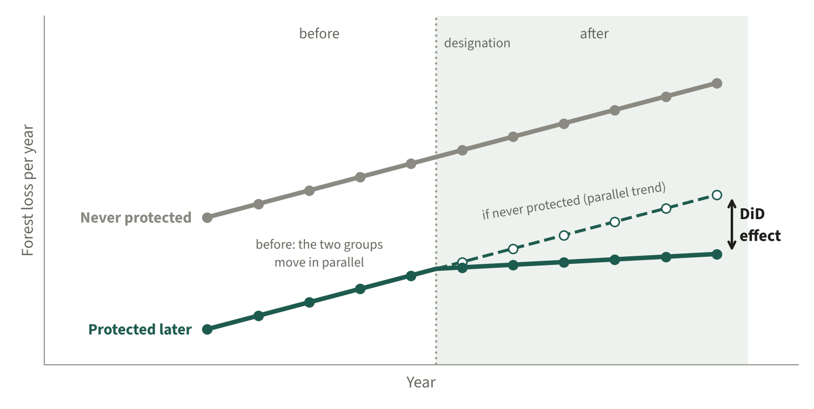

Units 2 and 3 compared protected and unprotected cells at one point in time. This unit is open: decide how you would use **change over time** to estimate the effect of protection, then try it. Run `00_layers.qmd` first.

{#fig-concept fig-alt="Concept: compare the change in protected land with the change in unprotected land."}

```{r}
#| label: setup
library(dplyr)
library(tidyr)
library(ggplot2)
library(fixest)   # feols(), sunab()
cells <- readRDS("data/cells.rds")
```

# The problem

Some parks were designated after the satellite record began, so for their cells we see forest loss both **before** and **after** protection. Never-protected cells give a comparison over the same years.

What the table gives you:

- `loss_2001` … `loss_2023`: share of the cell's 2000 forest lost each year
- `pa_year`: year the cell's earliest park was designated (`NA` = never protected)
- `pre_loss`, `dist_frontier`, `dist_road`, `elev`, `slope`, `pop`, `district`: covariates

```{r}
#| label: when
cells |> filter(!is.na(pa_year), pa_year > 2005) |> count(pa_year)
```

# Your task

Plan before you code. Write your answers down (a few sentences or a sketch each), then implement and check them.

1.  **The question.** What effect are you estimating, for which cells, and over what period?
2.  **The DAG.** Draw it with time: loss before, loss after, protection, and an unobserved `U`. What does a before-and-after comparison let you ignore, and what must still be true?
3.  **The groups.** Which cells are treated and which are comparisons? Which cells would you leave out, and why? How many treated cells do you end up with?
4.  **The data.** What shape does the data need? (Hint: one row per cell per year.)
5.  **Look before you estimate.** Plot average yearly loss by group. What would you want to see before trusting a comparison?
6.  **The estimate.** Compute it by hand from group means first, then with a regression. What does each add?
7.  **Checks.** How could you test your main assumption? Does the effect appear at once, grow or fade? Do results change if you change the treatment window, the comparison cells, or add covariates?

::: {.callout-tip title="Hints" collapse="true"}
- Cells designated in different years are treated at different times. A single "post" indicator would be wrong for them.
- `feols(y ~ x | cell + year, data, cluster = ~cell)` fits a two-way fixed-effects model; `sunab(cohort, year)` gives an event study that compares each cohort with never-treated cells.
- Cell fixed effects already absorb anything constant about a cell, so adding elevation or slope as plain controls does nothing. Covariates only matter if they let trends differ.
- Matching cells on `pre_loss` and covariates before running DiD is common in the protected-area literature. What does it do to the pre-trend check?
:::

::: {.callout-note title="Discuss"}
1.  Compare your estimate with the RD and matching estimates. Which assumption does each rely on?
2.  What does DiD still not fix? (Think about spillover to the comparison cells.)
3.  Parks designated mid-record may not be representative. What does that mean for how far you can generalise?
:::
